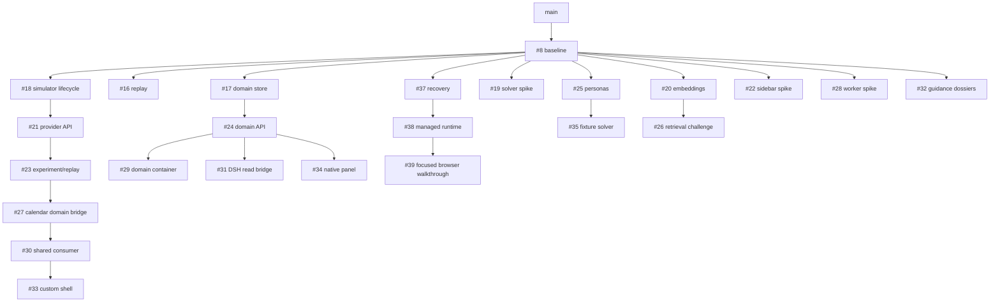

# Draft PR consolidation proposal

**Inspected 13 November 2026. Proposal only.** No PR was merged, retargeted or closed and no source branch was rewritten or deleted by this review. A fresh GitHub CLI inspection reports 24 open draft PRs and successful reported checks at inspection. Checks reflect each existing base, not the future integrated stack. The earlier [head inventory](evidence/pr-inventory-2026-11-12.md) remains historical evidence; #38 has since advanced to `38da40034632` and contains 113 changed files relative to #37. The browser child is now #39, inspected at `934b0fb19ddf`; its scripted browser evidence does not establish a live Luna walkthrough.

## Current dependency map

Solid arrows mean the current PR base relationship, not a merge recommendation. Dotted arrows below are proposed future work.

## Review and preservation map

Each PR below links to its original evidence. A destination marked “candidate” is not confirmation that its tests or behavior have already been preserved. Keep every source branch until that check and the intended disposition are reviewed.

| PR / current base | Proposed disposition and unique value to preserve |
| --- | --- |
| [#8](https://github.com/Residencia-em-IA-Challenge-2-Grupo-12/DSH-Prototype/pull/8) / main | Keep the bounded experimental baseline. Review readiness and the resulting integrated diff before the user's explicit merge decision. Head `6bce31c1ab13`. |
| [#37](https://github.com/Residencia-em-IA-Challenge-2-Grupo-12/DSH-Prototype/pull/37) / #8 | Review recovery and state coordination independently, including migration, uncertain writes and unavailable-calendar UI. Its unresolved-run limitations remain acceptance items, not proof of a finished workflow. Head `bad383e8721b`. |
| [#38](https://github.com/Residencia-em-IA-Challenge-2-Grupo-12/DSH-Prototype/pull/38) / #37 | Freeze infrastructure scope; review provider/claim, lifecycle/retirement, broker/agent, evidence and model-routing units at pinned heads. Prefer a focused browser integration child; do not mechanically rewrite this dependency-heavy PR just because it is large. |
| [#39](https://github.com/Residencia-em-IA-Challenge-2-Grupo-12/DSH-Prototype/pull/39) / #38 | Focused companion/controller RPC, runtime-policy preparation, review guidance and scripted browser evidence. Keep draft pending the actual Luna route/tool audit, live workflow and remaining delivery checks. Do not import the broader comparison stacks to finish the demonstration. |
| [#16](https://github.com/Residencia-em-IA-Challenge-2-Grupo-12/DSH-Prototype/pull/16) / #8 | Candidate consolidation with #23. Preserve dedicated replay unit/integration tests; do not close on converter-code equality. |
| [#18](https://github.com/Residencia-em-IA-Challenge-2-Grupo-12/DSH-Prototype/pull/18) / #8 | #38 carries an evolved runner and isolation tests. Preserve original lifecycle documentation and compare every original acceptance case before proposing supersession. |
| [#21](https://github.com/Residencia-em-IA-Challenge-2-Grupo-12/DSH-Prototype/pull/21) / #18 | #38 carries the API client and unit tests with evolved integration tests. Preserve OAuth, paging, ETag and management/provider boundary evidence before proposing supersession. |
| [#23](https://github.com/Residencia-em-IA-Challenge-2-Grupo-12/DSH-Prototype/pull/23) / #21 | Retain portable fixture/replay lineage and fresh-approval semantics; this broader experiment contract is not replaced by #38's conservative recovery archive. Reconcile #16's tests. |
| [#17](https://github.com/Residencia-em-IA-Challenge-2-Grupo-12/DSH-Prototype/pull/17) / #8 | Retain domain revision/proposal history tests for comparison with the working state module. Do not assume #37's different state contract supersedes this experiment. |
| [#24](https://github.com/Residencia-em-IA-Challenge-2-Grupo-12/DSH-Prototype/pull/24) / #17 | Retain HTTP contract and transactional-service evidence. A full domain-service adoption is later than the thin walkthrough and needs contract reconciliation. |
| [#27](https://github.com/Residencia-em-IA-Challenge-2-Grupo-12/DSH-Prototype/pull/27) / #23 | Retain evolved store/service and observer/approved-create tests. Its single-create bridge is not a multi-action recovery replacement; reconcile with #17/#24 and #37/#38 instead of importing all copies. |
| [#30](https://github.com/Residencia-em-IA-Challenge-2-Grupo-12/DSH-Prototype/pull/30) / #27 | Keep shared-context/proposal/review consumer evidence for the interface comparison. Rebase only after the chosen shared seam stabilizes. |
| [#22](https://github.com/Residencia-em-IA-Challenge-2-Grupo-12/DSH-Prototype/pull/22) / #8 | Compare registration/descriptors and limitations with #34 before a supersession proposal. Preserve distinct native-sidebar findings. |
| [#31](https://github.com/Residencia-em-IA-Challenge-2-Grupo-12/DSH-Prototype/pull/31) / #24 | Retain read-only DSH bridge and denial/descriptor evidence; compare with #34 rather than equating their responsibilities. |
| [#33](https://github.com/Residencia-em-IA-Challenge-2-Grupo-12/DSH-Prototype/pull/33) / #30 | Keep custom-interface experiment and same-data comparison artifacts. It does not select the final interface. |
| [#34](https://github.com/Residencia-em-IA-Challenge-2-Grupo-12/DSH-Prototype/pull/34) / #24 | Keep native-panel experiment and checks. Complete questions, revision, approval, recovery and localization comparison before selection. |
| [#19](https://github.com/Residencia-em-IA-Challenge-2-Grupo-12/DSH-Prototype/pull/19) / #8 | Candidate consolidation with #35, preserving toy-solver cases and CI discovery differences; no planner selection implied. |
| [#25](https://github.com/Residencia-em-IA-Challenge-2-Grupo-12/DSH-Prototype/pull/25) / #8 | Retain bilingual realistic personas, source/generation inputs and fixture validation. Large generated data diffs require reproducibility and source review. |
| [#35](https://github.com/Residencia-em-IA-Challenge-2-Grupo-12/DSH-Prototype/pull/35) / #25 | Retain fixture-based solver comparison, transition sensitivity and recorded results. Reconcile #19 instead of losing earlier test discovery. |
| [#20](https://github.com/Residencia-em-IA-Challenge-2-Grupo-12/DSH-Prototype/pull/20) / #8 | Keep embedding screen scaffold and resource-cap evidence. Smoke checks do not select one of the four candidates. |
| [#26](https://github.com/Residencia-em-IA-Challenge-2-Grupo-12/DSH-Prototype/pull/26) / #20 | Keep bilingual challenge/corpus/labels and known limitations; reviewed exploratory labels are not a pristine held-out benchmark. |
| [#28](https://github.com/Residencia-em-IA-Challenge-2-Grupo-12/DSH-Prototype/pull/28) / #8 | Retain worker isolation and negative-control tests. It is not a complete DSH-session sandbox and does not enable Bash in the actual demo. |
| [#29](https://github.com/Residencia-em-IA-Challenge-2-Grupo-12/DSH-Prototype/pull/29) / #24 | Retain domain-service Docker packaging evidence. Domain-only Compose is not a complete companion/controller/agent stack. |
| [#32](https://github.com/Residencia-em-IA-Challenge-2-Grupo-12/DSH-Prototype/pull/32) / #8 | Retain inactive guidance dossiers, source applicability and translation status. Human admission remains required before the guidance is active. |

## Comparisons actually checked

Local origin refs matched the inspected heads for these comparisons:

- #16 and #23 have identical `src/calendar-replay.mjs`; #23's tree contains experiment tests but not #16's dedicated replay test files. Converter equality therefore does not establish test preservation.
- #19 and #35 have identical `experiments/solver_comparison.py` and `tests/test_solver_comparison.py`; their solver workflow differs. Preserve the broader discovery behavior when consolidating.
- #21 and #38 have identical API-client and API-unit-test content in the compared paths; the integration test changed substantially. Compare its assertions before closing #21.
- #18 and #38 differ in the runner and both lifecycle test paths. The later code is evolved, not a byte-identical replacement.

This is a targeted preservation review, not a complete security or line-by-line review of all PRs. Refresh heads and compare again before acting.

## Proposed sequence and gates

1. Review #37 and #38 at fixed heads while implementing the narrow browser walkthrough in a child. Preserve the broader comparisons; do not pull them into the demo merely to reduce PR count.
2. Prepare #8 readiness with the proposed integration order, unresolved limitations and exact resulting diff. No #8 merge before the user's explicit decision. A child merge into a feature parent changes that parent's review scope.
3. For reviewed and approved integration, prefer preserving ancestry for these heavily stacked branches. If squash/rebase is selected instead, record the old parent boundary and reconstruct child diffs deliberately; verify no parent changes reappear.
4. After the relevant replacement is integrated and its evidence map is accepted, propose closure of specific superseded spikes with retained destinations and source refs. Do not delete the original refs merely to make the board shorter.
5. Retarget remaining experimental stacks individually against the stable foundation, compare the new effective diff, rerun affected checks and update links. Interface/planner/embedding selections and real-data readiness stay separate decisions.

## Português: orientação resumida

Este documento propõe uma consolidação sem perda; não autoriza merge, encerramento, alteração de base ou exclusão de branches. As setas representam as bases atuais. Primeiro, revisar #37/#38 e concluir o fluxo sintético no navegador; depois, apresentar a prontidão do #8 para a decisão explícita do usuário. Preservar código, testes, documentação, geradores e resultados exclusivos antes de encerrar qualquer experimento. A tabela completa é o mapa de preservação; candidatos ainda não comprovam substituição. As comparações de interface, planejador e embeddings continuam com suas decisões próprias.
