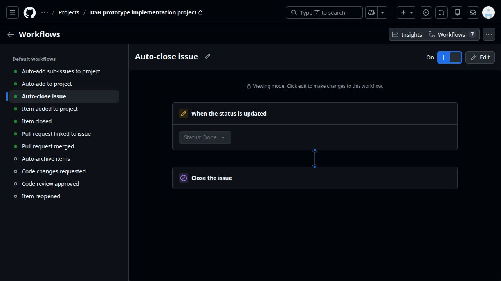

# Project organization audit and cleanup proposal

**13 November 2026 · Proposal only.** Implementation paused for this audit. No GitHub labels, owners, statuses, issue bodies, relationships, views, automations or PR dispositions were changed. Source implementation head: `3b964a3`. The Project is private; links require access.

The recent pass improved sequencing, but left classification, ownership, view configuration, automation semantics and handoff maintenance incomplete. The Project should answer **what to work on, why, what is settled, what is blocked, what evidence exists and what happens next** without requiring this chat.

The user subsequently authorized the bounded cleanup. See [applied changes and verified exceptions](project-organization-cleanup.md); the findings below remain the pre-change snapshot.

## What was inspected

All 19 issues, all 24 draft PR descriptions/metadata, all 23 Project items, native issue hierarchy/dependencies, all six saved views and their fields/filters/sorts, field values, labels, milestones, repository entry points, contribution/templates/workflow guidance and relevant roadmap/status documents. Two GPT-6 Luna subagents independently read issue organization and agent guidance. Native relationships were checked separately because their absence from `gh project item-list` is not evidence that they do not exist.

All 11 available Project workflow configurations were inspected through the browser; seven are enabled. Branch protection/ruleset inspection returned HTTP 403 with a GitHub plan-upgrade restriction, so their configuration could not be verified. This was an organization audit, not a fresh code, security, runtime or learning-effectiveness review.

[Structured snapshot and proposed classification of every issue/PR](evidence/project-organization-audit-2026-11-13.json). Raw read snapshots remain under `/tmp/study-org-audit-2026-11-13/` on the audit machine; they are not permanent project authorities.

## Main findings and fixes

| Finding | Why it matters | Proposed fix |
| --- | --- | --- |
| 14/19 issues and 24/24 PRs are unlabeled. | Areas and experiments cannot be filtered reliably. | Apply one primary area plus an existing work type or explicit epic/experiment classification. |
| No issue or PR has an assignee; no milestones exist. | “My items” is empty and accountability/phase are unclear. | Agree real owners for active leaf work; introduce undated delivery milestones. Do not invent owners or dates. |
| 19/23 Project items are In progress; four are Backlog. | Broad tracking items and paused work look like current execution. | Define status by observable conditions and distinguish tracking epics from actionable work. Re-triage scope before changing older statuses. |
| Priority has no options; only Status has populated custom values. | “Prioritized backlog” cannot express priority. | Define P0/P1/P2 and populate real near-term ordering; hide unused planning columns from everyday views. |
| “Bugs” has no filter. “Prioritized backlog” has no filter and sorts by Status. | Named views imply distinctions they do not make. | Fix the existing views in place; verify the returned set and ordering. |
| Auto-add includes open issues only; 20 draft PRs are outside the Project. | The board does not expose the full experiment/PR inventory. | Add those PRs as retained experimental work and provide a filtered PR inventory; keep issue execution and PR disposition distinct. |
| Older #1–7/#10–11 have thin bodies; broad blockers remain. | Readers cannot distinguish original scope, current gaps or specific prerequisites. | Reconcile their remaining acceptance against newer focused issues; refine broad dependencies through concrete readiness requirements. |
| #39's PR body says companion wiring and plugin catalog are unverified and no live calls occurred. | It contradicts current evidence on its own branch. | Refresh its own-scope summary with scripted browser vs real Luna API evidence and remaining browser/recording gaps. |
| README EN/PT still say Luna is the only authorized model; the newer bounded DeepSeek authorization is documented elsewhere. | Agents can encounter conflicting model policy at the entry point. | Link one current routing policy and keep baseline versus bounded comparison clear in both languages. |
| Project README/description and repository description are empty. Main has only scaffold documentation, with no runnable package.json. | A new reader lacks a starting path and cannot find the active draft implementation reliably. | Add a short context/routing entry point with links to #9, #40/#41, evidence and current branch instructions. |
| Contribution guidance lacks a checkable board/issue/PR handoff step. | Code completion can leave organizational work stale. | Put one Start/Handoff procedure in CONTRIBUTING and strengthen existing templates; use a short root AGENTS pointer. |

These are proposed changes, not evidence that a label or current implementation already satisfies an acceptance criterion. Zero comments/milestones/closed issues is not itself a defect: the material problem is missing current ownership, actionable scope and disposition.

## Automations need attention before bulk status cleanup

| Observed enabled workflow | Actual behavior | Recommendation |
| --- | --- | --- |
| Auto-close issue | Setting Status to Done closes the issue. | Disable this direction while adopting acceptance-based closeout. Explicitly close an issue after recording completion/disposition, then let closure update the board. |
| Item closed | Closing either an issue or PR sets Done. | Keep issue-closure→Done only with explicit outcome/disposition in the human closeout process; native automation cannot inspect acceptance. Use PR-merged→Done for integrated PRs and preserve a separate explicit disposition for closed-unmerged/superseded PRs. |
| Pull request linked to issue | Sets In progress. | Disable unconditional promotion. A future spike or draft reference does not mean active implementation or satisfied prerequisites. |
| Pull request merged | Sets Done on the PR item. | Keep, while making clear that merge does not automatically complete an epic, choose a foundation or admit guidance. |
| Item added | Sets Backlog for issues/PRs. | Keep as a conservative default. |
| Auto-add sub-issues | Adds them to the Project. | Keep. |
| Auto-add to project | Repository filter `is:issue is:open`. | Extend to the repo's intended open PR inventory, with views that separate research PRs from active issues. |

Auto-archive, changes-requested, review-approved and reopened templates are not enabled. Do not enable their default “Ready” transitions without defining the intended lifecycle. No automation was edited during this audit.

The existing Done→close rule makes a status migration consequential. Review/reconfigure it **before** mass status edits, not afterward.



## Compact label, milestone and status scheme

Reuse `bug`, `enhancement` and `documentation`. Add only:

- `kind:epic` — an outcome tracked through bounded work; not an active leaf task.
- `kind:experiment` — a research/comparison artifact, with a question and evidence outcome; merging it does not select an implementation.
- `area:calendar`, `area:runtime`, `area:planning`, `area:knowledge`, `area:interaction`, `area:evaluation`, `area:delivery`.
- `needs:decision` — temporary attention label **only when** a concrete artifact and explicit question are ready for a human decision. It is not a general synonym for “future choice.”

`knowledge` covers selected materials, fixtures, retrieval and guidance; `delivery` covers setup, CI, onboarding documents and integration/project organization. Use one primary area; add a second only when it materially helps discovery. The structured snapshot proposes labels for all 19 issues and all 24 PRs. Replace generic `question` on #41/#43 with their precise work/evidence purpose rather than implying the agent is waiting for unspecified information.

Use milestones for delivery outcomes instead of adding phase/status labels:

1. Synthetic demonstration and baseline readiness.
2. Foundation decisions and bounded experiments, including the later #42/#43 exploration.
3. Selected collaborative workflow.
4. Frozen evaluation and review.

Start without due dates. Assign a PR to a milestone only if its intended integration/disposition belongs there; do not make a milestone require every experimental branch to merge.

Priority: **P0** current critical path/blocker; **P1** next scoped work; **P2** later planned work. Proposed immediate focus: #40 and #41, with bounded recovery #36 and readiness #9 as the relevant gates. #42/#43 stay Backlog after #9. Assign active work to an actual accountable maintainer; record agent execution context in the handoff, not as a fictional GitHub assignee.

| Existing status | Meaning for an actionable issue |
| --- | --- |
| Backlog | Intentionally deferred or still awaiting scoping/prerequisites. |
| Ready | Small enough to start; acceptance, required inputs, dependencies and responsible owner are clear. |
| In progress | Work is actively being performed, with a concrete next action. |
| In review | An inspectable artifact awaits a named kind of review or decision. A PR may remain draft while scoped evidence is reviewed. |
| Done | Stated outcome was verified, or an explicit cancellation/supersession disposition was accepted and retained work is linked. This is not a claim of product adoption. |

An epic may track In progress through its children; the daily execution view should exclude epics. Missing ownership on future discovery work need not block documenting it, but Ready/In progress should have an accountable person or explicit ownership gap.

## Repair existing views, preserve useful conventions

| Existing view | Proposed use |
| --- | --- |
| Prioritized backlog | Open actionable Backlog/Ready issues, grouped/sorted by Priority; show area, owner, milestone, parent and relevant linked PR. |
| Status board | Day-to-day leaf issue execution; show owner, area, priority and visible blocker context. Avoid counting epics and their PRs as separate units of the same work. |
| Roadmap | Agreed delivery stages/milestones; actual dates only when the team commits to them. Empty date fields are not a schedule. |
| Bugs | Filter to `bug`; currently only #36 is labeled, so review undisposed findings before assuming that is complete bug coverage. |
| In review | Actual artifacts awaiting review, with reviewer/question/evidence visible; use `needs:decision` only when ready. |
| My items | Genuine assignees; populate owners rather than changing the filter to hide missing ownership. |

Add one **PR inventory** view if all draft PRs join the Project: show parent/base, purpose, related issue, preservation destination and current review/disposition. Some of that belongs in the PR body rather than new custom fields. Keep Size/Estimate/Iteration/Start/Target fields available, but hide them from everyday views until they are used. Do not populate guessed values to make columns look complete.

## Issue and dependency reconciliation

Native relationships already exist: ten parent edges and twelve blocking edges. Keep them; do not rebuild hierarchy from missing fields in a CLI projection.

- **#1–7:** original demo programme/work packages. Define which bounded original outcomes are satisfied in draft code, which need current #9/#40 verification and which remaining work belongs to #10–15. Close only after an explicit acceptance/disposition review, with links; do not silently mark them complete because code exists in a draft.
- **Existing #9 parentage of #40/#41:** preserve this current readiness structure. Consider making #9 a child of the original #1 programme so the current delivery path is discoverable there; preserve #2–7 as historical/remaining work until reconciliation is complete.
- **#36:** relate the bounded recovery acceptance to #9/#41. Its current scope and deferred in-place reconciliation need one current checklist; move long superseded candidate checklists into a linked dated history instead of leaving competing “remaining” checklists in one body.
- **#10–12 → #13:** all three currently block the comparison epic. Review which precise common-service/lifecycle/runtime readiness is needed to start each comparison. Full worker/file-editing scope must not accidentally become a prerequisite for every read-only experiment. Preserve required boundaries while refining these edges; do not delete blockers simply to make the board green.
- **#13:** use separate bounded interface, planner and embedding comparison tasks tied to their existing PR evidence and explicit selection questions. This permits different readiness and review outcomes without turning the epic into one undifferentiated task.
- **#14 → #42/#43:** keep their native #9 dependency. Explain that these are bounded discovery inputs, whereas full selected-workflow adoption remains behind #13. A parent epic's adoption gate must not be misread as an instruction to implement the entire architecture before testing an authored example.
- **#15:** retain the 36-episode plan and separate later cost/definition review. It remains outside first-demo readiness.

Keep product decisions, runtime prerequisites and PR ancestry distinct. “Related,” “blocked by” and “based on” mean different things.

## Prevent drift with one contribution workflow

Use the existing `.github/CONTRIBUTING.md` as the workflow authority and `.github/STACKED_PRS.md` for Git mechanics. Avoid another competing policy document. Add a short repository-root `AGENTS.md` pointer so agents discover those rules automatically; fixture AGENTS files are student data, not contributor policy.

Proposed root pointer, **not applied**:

```markdown
Before starting or resuming repository work, read .github/CONTRIBUTING.md
for issue/Project handoff, evidence and decision-gate requirements.
Before changing a PR base, integrating branches or proposing supersession,
read .github/STACKED_PRS.md.
```

Proposed additions to CONTRIBUTING:

**Start:** identify the canonical issue, its why/acceptance/decisions, parent/blockers, Project status, linked PR and actual branch/base/head. Preserve local work. Distinguish verified implementation, experiment results, proposals and adopted decisions. Refresh live state before editing it.

**Handoff:**

1. Account for each current acceptance item as met, unmet or not observed. Link evidence with source commit/configuration, command/observation and limits. Preserve failed attempts and residual work.
2. Update the canonical issue's current result, next action and blockers. Synchronize actual labels, parent/dependency links and Project status; then read back the result. Report inaccessible updates explicitly instead of claiming sync.
3. Refresh the PR body's own scope, base/parent, tested code revision, results and remaining acceptance. Child evidence does not become parent evidence until integration and revalidation.
4. Keep merge, foundation selection, guidance admission and real-data authorization as their explicit review gates. An artifact can be ready for discussion without authorizing its adoption.
5. Before closure/supersession, map unique code/tests/fixtures/docs/results/CI to retained destinations or an accepted disposition. Retain references until that disposition is reviewed.

**Completion criterion:** a coding slice is not fully handed off until its issue/PR/Project state has been verified, or the exact synchronization blocker and next action are recorded. This does not require rerunning model/tests for label-only edits; evidence requirements follow changed behavior/configuration.

Small template edits should collect outcome/why, scope, current acceptance, parent/blockers, decision-source link, evidence destination and next action. Exploratory issues should specify the question/result to produce, not pretend an implementation has been selected. The PR template should include a short issue/Project synchronization confirmation. Keep these requirements in CONTRIBUTING rather than repeating the full checklist across every document.

## Sources of truth and a read-only maintenance check

| Surface | Owns |
| --- | --- |
| Issue + Project fields | Current outcome, acceptance, owner, status, priority, dependencies, next action and open decision. |
| PR + Git refs | Proposed code scope, actual ancestry, tested revision, review/disposition and retained evidence. |
| Repository decision/architecture docs | Durable accepted rationale, provisional scope and operating boundaries. |
| Versioned evidence | What was observed, with runtime/configuration, date and limitations. |
| Project README / main README | Short routing/context entry point, with links rather than duplicated live counts. |

Current dated reports stay historical snapshots. Reduce repeated status/count/head prose in README, roadmap, review brief and progress notes; link the canonical live issue and pinned evidence instead. In particular, update #39's stale PR body and both model-policy entry points before relying on them for handoff.

Start with a cheap, **read-only** maintenance script/checklist that flags unlabeled active work, unowned In progress leaf issues, missing parent/PR references, missing evidence/next action, drift between draft/head descriptions and current reports, and unexpected view/filter changes. Use warnings for semantic checks. It must not automatically close, reopen, reassign or move work. Add scheduled CI only after the checks are useful and private Project access can be granted narrowly; the current contents-read workflow does not automatically provide that access.

Merge commits, squash and rebase are all enabled; automatic branch deletion is off. Keep that preservation-friendly setting. Branch protection/rulesets could not be audited because the API returned a plan restriction. Do not assume these human review gates are server-enforced, change repository visibility or buy a plan as an incidental cleanup step.

## Bounded adoption order

1. Snapshot current configuration (done for this audit); agree the compact workflow/classification and guard the consequential automation transitions before status cleanup.
2. Consolidate CONTRIBUTING/templates and add the root pointer so this cleanup itself follows a checkable handoff. Main has basic CONTRIBUTING but lacks the newer stacked-PR guide and root agent pointer, so consider a small, independently reviewed navigation/policy-only bootstrap change before the experimental code baseline; it still requires normal review and does not merge #8.
3. Correct view filters, configure Priority and a small milestone set, and apply the proposed issue/PR classification. Add missing PR inventory entries without merging or closing them. Assign only real ownership.
4. Reconcile #1–7/#10–13 scope and blockers, refresh #39 and current issue handoffs, and preserve older investigation text in clearly dated references.
5. Verify via the real board and API: expected issue sets in each view, owner/priority coverage for active work, unchanged intended gates, no accidental closures, all retained PRs reachable, and no lost evidence/history. Track this cleanup under existing #41 rather than create a second organisation programme.

No new study-method implementation, foundation selection or PR integration is included in this proposal. Resolve this small organizational pass before returning to #40's delivery work.
