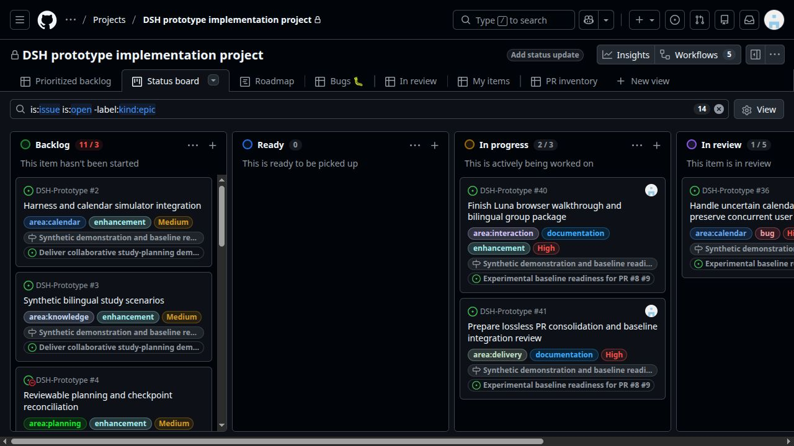
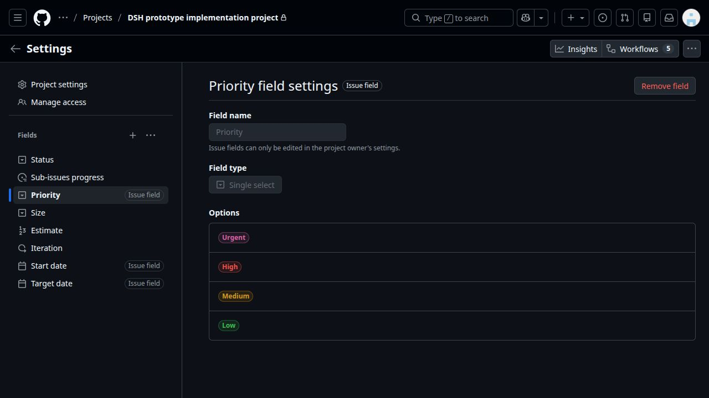
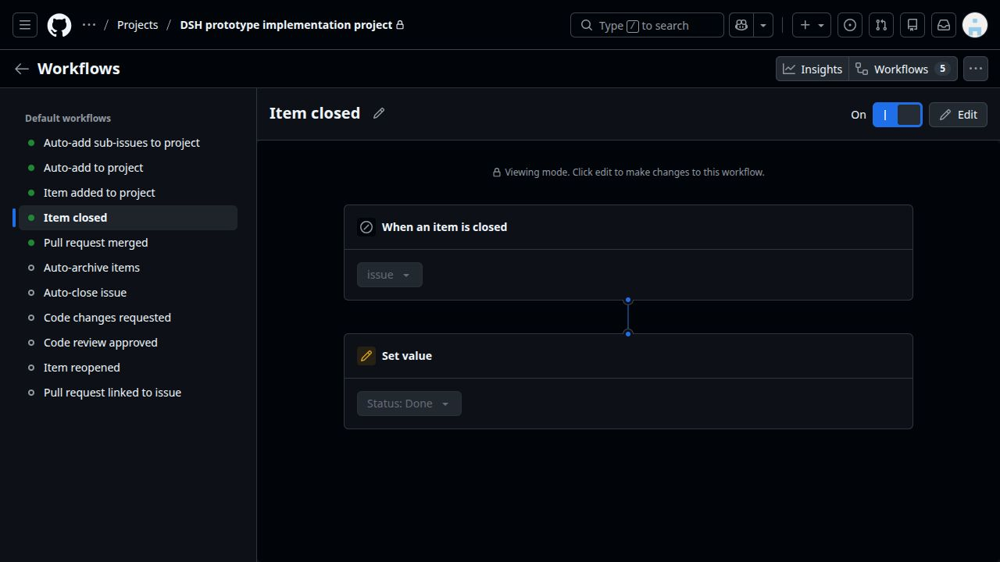

# Project organization cleanup

**Verified 13 November 2026.** Applied under #41 after the user's acceptance of the [organization audit](project-organization-audit.md). This round changes navigation, classification and handoff practice; it does not complete the demonstration or integrate any PR.

[Open the daily board](https://github.com/orgs/Residencia-em-IA-Challenge-2-Grupo-12/projects/1/views/2) · [PR inventory](https://github.com/orgs/Residencia-em-IA-Challenge-2-Grupo-12/projects/1/views/7) · [Current readiness gate #9](https://github.com/Residencia-em-IA-Challenge-2-Grupo-12/DSH-Prototype/issues/9)

## What changed

| Surface | Applied result |
| --- | --- |
| Issues and PRs | All 22 open issues and 24 retained draft PRs have a primary area/work classification and an undated outcome milestone. The three new issues are bounded children, not new product scope. |
| Current ownership | `d4vidz` is coordinator for #40 delivery, #41 integration/organization and #36 recovery review, as explicitly selected. Other owners/dates were not invented. |
| Execution | #40/#41 are In progress; #36 is In review. #1/#9 track the active programme/readiness as epics. Older #2–7 and foundation #10–13 are Backlog with concrete next actions; this records deferred execution/acceptance review, not absence of draft implementations. |
| PR disposition | #37/#38 are In review for scoped evidence/code review while still draft; #8/#39 remain In progress. Twenty experiment PRs are retained in Backlog pending their comparisons/preservation disposition. No PR is declared superseded. |
| Foundation tasks | #44 interface, #45 planner and #46 embedding screening are children of #13 with distinct inputs, observable outcomes and selection questions. Their narrower experiment readiness is separated from full adoption gates. |
| Current issue bodies | #1–7/#9–15/#36/#40–43 now state current scope/evidence, remaining acceptance and next action. #36 has one current disposable-replacement checklist; earlier reconciliation candidates are historical. Complete old #9/#36 bodies are retained in [history](history/). |
| Navigation | Bilingual Project README, short Project/repository descriptions, README route/runtime clarification and the refreshed #39 PR body point readers to current authorities. |
| Handoff | CONTRIBUTING owns one Start/Handoff procedure; root AGENTS points to it; issue/PR templates collect short evidence/next-action context. A read-only checker surfaces structural drift. |

All **46** open issues/PRs are represented. Across the inventory, six items are In progress (including two epics and two PRs), three In review and 37 Backlog. These totals count different object types; the daily issue view correctly shows **two active leaf tasks and one recovery review**, not six independent development tasks.

## Priority correction and preserved conventions

The audit's Project API returned no Priority options. The UI and public issue-field API established that it is actually an **organization issue field**, with **Urgent / High / Medium / Low**. The attempted custom-field edit was rejected and changed nothing. We preserved the organization's options instead of adding a duplicate P0/P1/P2 field:

- High: #9/#36/#40/#41 current delivery/readiness path.
- Medium: original work-package review, shared foundations and the three bounded comparisons.
- Low: later selected workflow, larger evaluation and #42/#43 discovery.
- Urgent: left unused for exceptional blockers.

PRs do not receive fabricated issue-field priorities. Their view shows classification, milestone and review state; actual parent/base and preservation destinations remain in PR bodies and the [consolidation map](pr-consolidation-proposal.md). All 19 existing fields and six existing views were retained. No estimates, iterations or dates were guessed. Existing board column limits were preserved; an over-limit Backlog count is a retained display limit, not a claim that deferred work is active.

## Views and automations

| View | Verified purpose |
| --- | --- |
| Prioritized backlog | Open Backlog/Ready leaf issues, grouped and sorted by native Priority. |
| Status board | Open leaf issues; owner, classification, priority, milestone, parent and linked PR visible. Removed unused Iteration slicing and zero-valued Estimate sums from this everyday view. |
| Roadmap | Open tracking epics. It remains a roadmap layout; undated milestones are outcome stages, not promised calendar dates. |
| Bugs | Open issues with `bug`; currently #36. This is classification, not proof that no other defects exist. |
| In review | Open items actually marked In review; currently #36 and draft PRs #37/#38. The bodies define what review means. |
| My items | Retains `assignee:@me`; populated using genuine ownership. |
| PR inventory | New seventh view, retaining all 24 open draft PRs separately from issue execution. |

Done→automatic issue closure and PR-reference→automatic In progress are disabled. Explicit issue closure can still set Done, now for **issues only**. PR merge→Done, conservative new-item Backlog and auto-add sub-issues remain enabled. Auto-add now includes open issues **and PRs** in this repository. Five workflows remain enabled. Closing an unmerged PR still requires an explicit preserved disposition; it is not automatically represented as successful integration.

The original 10 parent and 12 blocking relationships were retained. Added #1→#9, #9→#36 and #13→#44/#45/#46, yielding 15 parent relationships. No blocker was removed. The #13 adoption gate still depends on #10–12; each child specifies the narrower readiness needed for a fair experiment. #42/#43 remain behind #9, and #15 retains the later 36-primary-episode plan.

## Verification and practical limits

The [structured readback](evidence/project-organization-cleanup-2026-11-13.json) records the issue/PR/view/field inventory and classifications. Verification used public GitHub REST/GraphQL, saved-view reloads and browser workflow inspection. It checked labels/milestones for all items, selected assignees/priorities, unchanged PR base/head branch identities at metadata readback (before publishing the focused cleanup commits on #39), retained relationships/fields/views and all PRs still draft. No issue was closed and no branch was merged, rewritten, retargeted or deleted.

The checker was syntax-checked and exercised against the original raw snapshot, the final frozen snapshot and live GitHub. Live readback reports **0 structural warnings and 2 informational notes**. That result does not establish semantic correctness, complete implementation, secure runtime or merge readiness. The checker does not audit every automation and uses bounded queries (up to 100 issues/100 cross-reference events in its relationship query, 50 views/fields); larger projects need pagination work. No new scheduled CI or private-project token grant was added. Documentation-only changes did not rerun unrelated model or application suites; prior 150-check evidence remains tied to its implementation revision.

Two economical Luna subagents drafted contributor guidance and the checker; the primary agent reviewed and live-tested them. Live validation found and corrected connection pagination and relationship accumulator errors before this handoff. External API failures/rejections did not justify assuming writes succeeded; actual results were read back.

**Remaining adoption gap:** contribution rules, checker and evidence are committed on the #39 draft stack, not yet on `main`. #41/#7 explicitly track bringing the reviewed navigation/policy to main through a small independent docs change or approved baseline integration. Until then, new contributors must use the Project's link to the current draft guide. This round does not authorize that merge.

Branch-protection/ruleset inspection is still blocked by the GitHub plan's 403 restriction. Review/merge gates must not be represented as server-enforced. No plan purchase, visibility change or access expansion was made. `needs:decision` exists but is intentionally unused: the baseline's missing browser/package acceptance means it is not yet ready for the final merge question.

## Next work

Resume #40's actual Luna browser walkthrough/recording feasibility and group package. Continue #41's pinned recovery/lifecycle and lossless preservation review alongside it. Present exact integration operations and the resulting #8 scope before the user's separate merge decision. Keep #42/#43 and all foundation selections in their later bounded checkpoints; this cleanup adds no study-method engine, model calls or real-data pilot.

## Português

A organização foi aplicada, não apenas proposta. O quadro diário mostra #40/#41 em execução e #36 em revisão, com `d4vidz` como coordenador. Todas as 24 PRs continuam abertas e em rascunho; os experimentos foram preservados. Foram criadas #44 (interfaces), #45 (planejadores) e #46 (embeddings), com requisitos próprios para comparações pequenas e decisões explícitas antes da adoção.

As issues antigas continuam abertas, com escopo, evidências, pendências e próximo passo. O histórico de #9/#36 foi preservado; reconciliação de alterações incertas no mesmo calendário continua adiada. A prioridade usa a convenção existente da organização, sem campos duplicados. As visões e automações foram corrigidas, e a rotina de início/entrega agora exige atualizar e conferir issue, PR e Project.

Ainda faltam o percurso real do Luna **no navegador**, a gravação ou replay identificado, o pacote bilíngue final e a revisão de prontidão/consolidação. As regras novas ainda estão no rascunho #39; sua adoção em main precisa de revisão. Nenhum merge ou escolha de arquitetura ocorreu nesta rodada.
