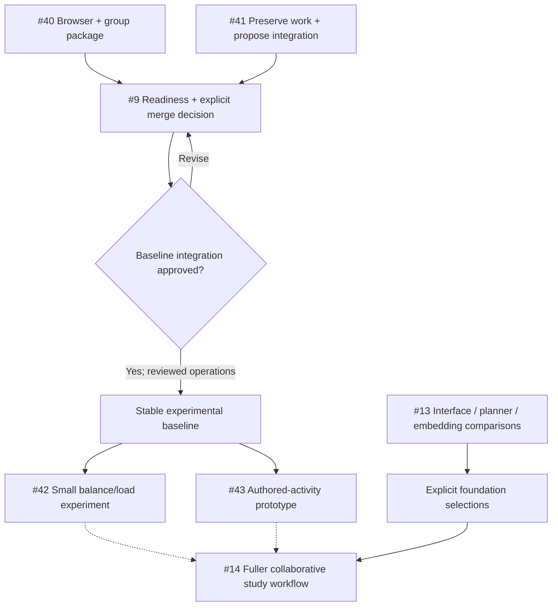

# Project work sequence

The baseline and #57 are merged. The [22 November closeout](review/baseline-closeout-2026-11-22.md) records the verified current scope, what remains, and the order for starting comparisons. This document preserves the earlier integration decision context.

For current delivery and integration review, see the [readiness report](review/onboarding-readiness-2026-11-17.md) and the [Project board](https://github.com/orgs/Residencia-em-IA-Challenge-2-Grupo-12/projects/1). The status table below is a historical snapshot.

Verified 13 November 2026. Issue/Project organization only: no PR was merged, closed, retargeted or rewritten. The existing six views and 19 fields were preserved; existing labels/status options were reused. No owners, due dates or new field options were invented.

## Current and later work

| Work | Project status | Relationship and completion meaning |
| --- | --- | --- |
| [#40 Luna browser walkthrough and bilingual package](https://github.com/Residencia-em-IA-Challenge-2-Grupo-12/DSH-Prototype/issues/40) | In progress | Child of #9. Finish the actual browser/group delivery; distinguish scripted browser evidence, real Luna API evidence and recording. |
| [#41 Lossless PR consolidation/integration review](https://github.com/Residencia-em-IA-Challenge-2-Grupo-12/DSH-Prototype/issues/41) | In progress | Child of #9. Prepare preservation evidence and exact proposed Git operations, not their execution. |
| [#9 Baseline readiness](https://github.com/Residencia-em-IA-Challenge-2-Grupo-12/DSH-Prototype/issues/9) | In progress | Refresh the bounded integrated-scope report and present the explicit #8 merge decision. |
| [#42 Horizon balance/load experiment](https://github.com/Residencia-em-IA-Challenge-2-Grupo-12/DSH-Prototype/issues/42) | Backlog | Child of #14; native dependency on #9. Small experiment on current scheduling decisions; no final planner selection. |
| [#43 Authored-activity/context prototype](https://github.com/Residencia-em-IA-Challenge-2-Grupo-12/DSH-Prototype/issues/43) | Backlog | Child of #14; native dependency on #9. Separate later discovery prototype that informs the spec. No full personalized learning system. |

#42 and #43 are not made mutually blocking: learn from #42 first where useful, but do not invent an unnecessary dependency if a small #43 representation test can proceed independently after the baseline checkpoint. Closing a GitHub dependency is not itself authorization to merge, select a foundation or access real data.

Arrows show the delivery/review logic, not authorization to execute Git operations. #40/#41 are native sub-issues of #9; #42/#43 are native sub-issues of #14 and blocked by #9. The diagram does not require all 24 open experimental PRs to merge.

## PR review boundaries

Current base relationships: `main ← #8 ← #37 ← #38 ← #39`. Inspect each child's own delta, then re-review the resulting parent diff if integration is approved. [The preservation map](pr-consolidation-proposal.md) retains all experimental branches/evidence until supersession is demonstrated. #41 will present exact operations and their consequences before any merge/retarget/closure. Existing interface/planner/embedding selections stay separate.

## Reconciled issue descriptions

- #9 now distinguishes baseline versus child-branch evidence and links the current delivery/review work. Its earlier evidence is preserved as historical text.
- #36 now records the agreed disposable-run recovery cut and deferred in-place reconciliation. Original reproductions/candidate designs remain preserved; the issue stays open.
- #12 now distinguishes Luna baseline, the bounded authorized DeepSeek comparison and actual runtime/tool-policy evidence. Full packaging/isolation remains incomplete.
- #14 links the agreed soft balance, current-horizon preferences and later authored-activity exploration.
- #15 retains 36 planned primary episodes and the later comparison/judge/cost boundaries; it is not a first-demo gate.
- PR #39 was added to the existing Project as In progress alongside its ancestors.

## Português

Primeiro, concluir navegador/pacote (#40) e preparar a revisão de integração sem perda (#41). Ambos alimentam a prontidão do #9 e a decisão explícita sobre merge do #8. Depois de uma base experimental estável, explorar equilíbrio/carga (#42) e poucas atividades escritas à mão (#43), ambos em Backlog e dependentes do #9.

Não é necessário fazer merge de todos os PRs experimentais antes disso. Preservar evidências e branches até revisar o destino de cada parte. As escolhas de interface, planejador, embeddings e acesso a dados reais continuam em decisões separadas. As seis visualizações e os 19 campos existentes do Project foram mantidos. Nenhum PR foi alterado por estas operações de organização.
